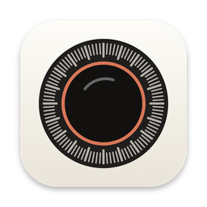
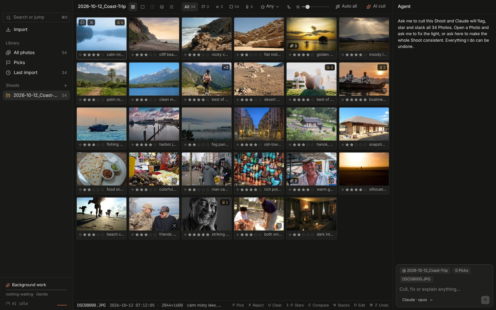
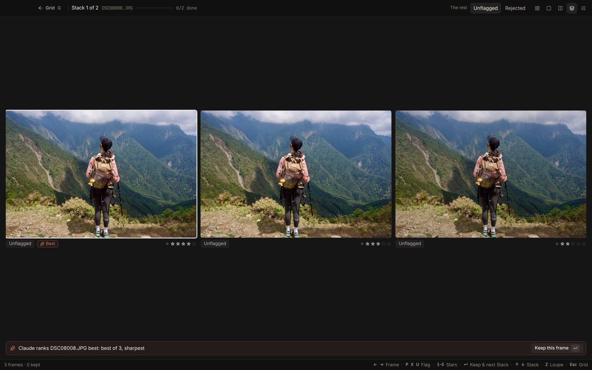
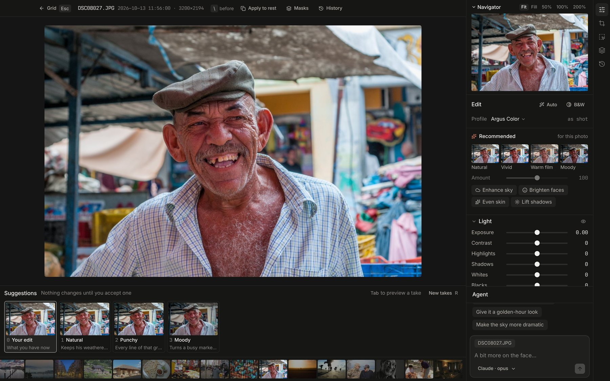
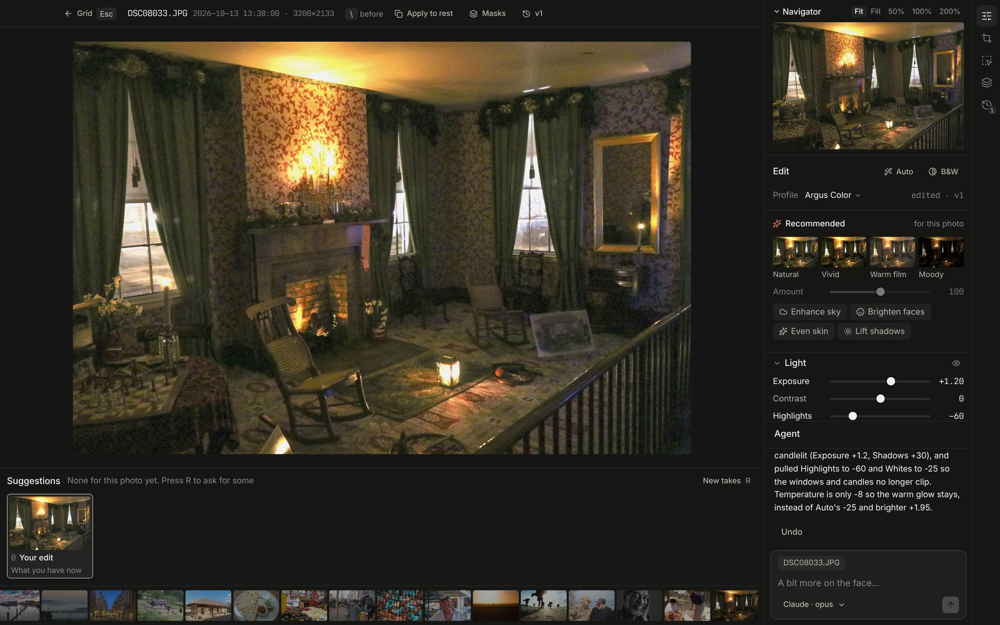

<p align="center">
  
</p>

<h1 align="center">Argus</h1>

<p align="center">
  An AI photo editor for the Mac that culls and edits a whole shoot for you.<br>
  The AI runs on your own computer, so your photos stay there.
</p>

<p align="center">
  <a href="https://github.com/gregorymfoster/argus-releases/releases/latest"><b>Download the latest version</b></a>
  &nbsp;·&nbsp;
  <a href="https://github.com/gregorymfoster/argus-app">Source code</a>
  &nbsp;·&nbsp;
  <a href="https://github.com/gregorymfoster/argus-app#set-up-the-ai">Set up the AI</a>
</p>

<p align="center">
  
</p>

## Install

Paste this into Terminal on a Mac with Apple Silicon:

```sh
curl -fsSL https://github.com/gregorymfoster/argus-releases/releases/latest/download/install.sh | bash
```

It checks your Mac, installs Argus, [Ollama](https://ollama.com) and the local AI model, and asks once before the big download. It never asks for your password and is safe to run again. Add `-s -- --dry-run` after `bash` to see what it would do without changing anything, or [read the script](https://github.com/gregorymfoster/argus-app/blob/main/scripts/release/install.sh) first.

You can also download the `.dmg` from the [latest release](https://github.com/gregorymfoster/argus-releases/releases/latest), open it and drag Argus into Applications. The first time you open it, macOS stops it because Argus isn't notarized by Apple. Go to System Settings > Privacy & Security, scroll to the note about Argus and click Open Anyway. You only do this once.

## What it does

Import a card and Argus looks at the whole shoot at once. It rates every photo, groups bursts into Stacks and flags frames that are plainly broken, so your own cull goes quickly. Then it offers two or three finished edits per photo that you can accept, dial down or ignore. You can also just ask it things, like "fix the lighting on this one", and undo anything it did in one step. Your original files are never changed.

Argus needs macOS 13 or later on Apple Silicon. The default model runs best with 32 GB of memory; with less, pick a smaller model or use your Claude plan.

## A closer look

<p align="center">
  
  <br><sub>Bursts become Stacks. Look at the frames side by side and press Enter to keep the best.</sub>
</p>

<p align="center">
  
  <br><sub>Each photo gets a few finished edits to choose from. Nothing changes until you accept one.</sub>
</p>

<p align="center">
  
  <br><sub>Ask for what you want in plain words. The Agent edits the photo, says what it changed, and Undo puts it back.</sub>
</p>

<sub>Sample photos are public domain or CC0 from Wikimedia Commons (<a href="screenshots/CREDITS.md">credits</a>).</sub>

## Why this repo exists

This repository only hosts the downloads. Installed copies of Argus check it for new versions and update themselves in the background. The app's source code is open under the MIT licence at [gregorymfoster/argus-app](https://github.com/gregorymfoster/argus-app).

Argus is a free side project by [Greg Foster](https://github.com/gregorymfoster). It isn't notarized because there's no paid Apple developer account behind it, which is the only reason macOS asks you to confirm it once. Found a problem? Tell Greg.
